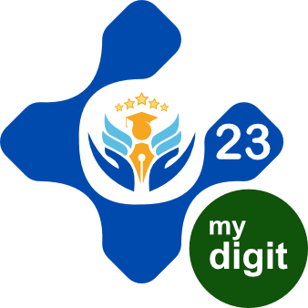
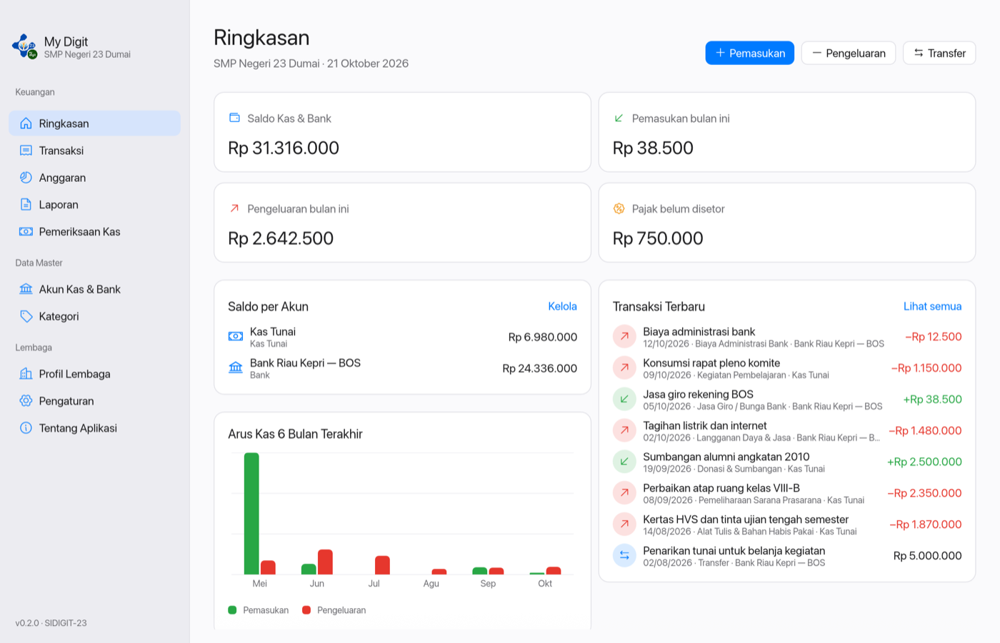
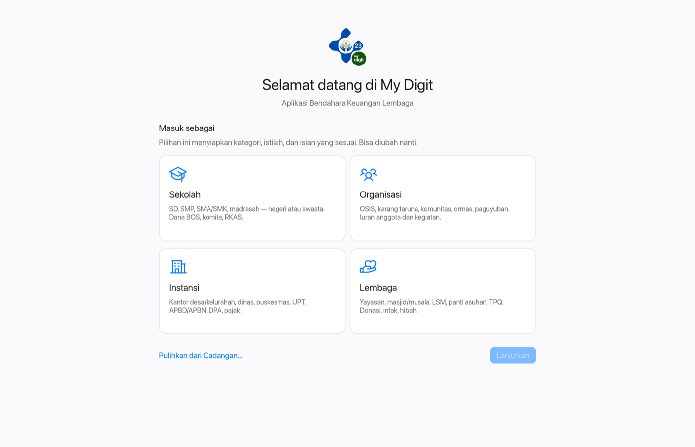
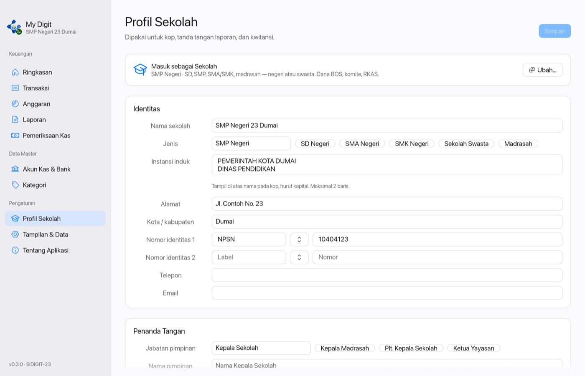
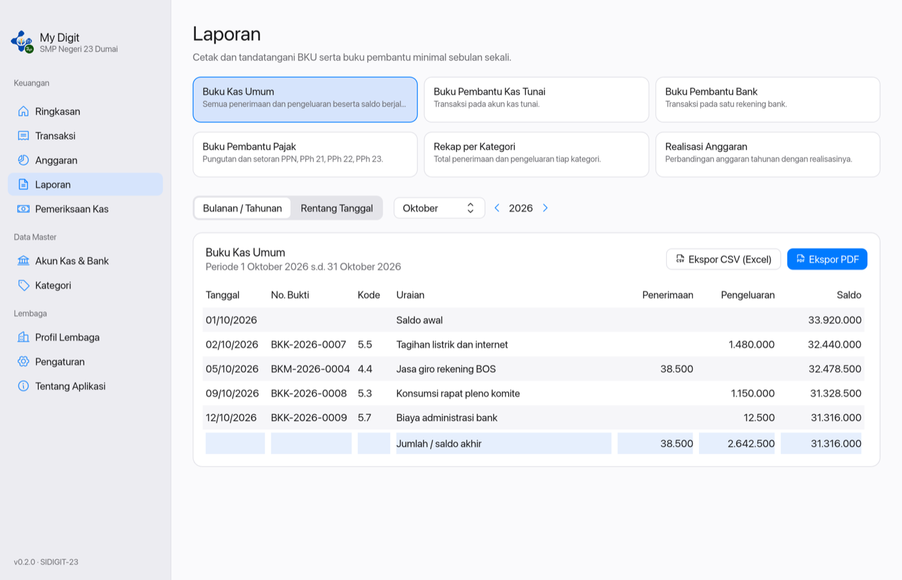
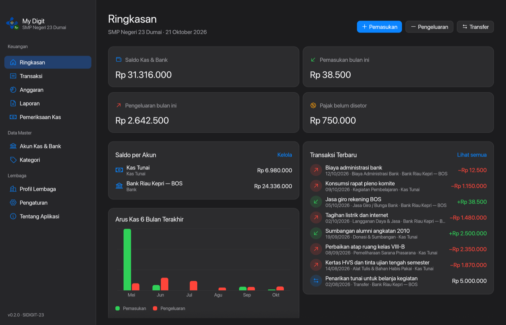

<p align="center">
  
</p>

<h1 align="center">My Digit</h1>

<p align="center">
  Aplikasi Bendahara Keuangan Lembaga untuk Windows dan macOS<br>
  <em>made by SIDIGIT-23 Proyek IT SMP Negeri 23 Dumai</em>
</p>

<p align="center">
  
</p>

---

## Tentang

**My Digit** membantu bendahara sekolah, organisasi, instansi pemerintah,
maupun lembaga (yayasan, masjid, LSM) mencatat keuangan dan menyusun laporan
yang siap ditandatangani. Saat pertama dibuka, pengguna memilih **Masuk
sebagai** Sekolah, Organisasi, Instansi, atau Lembaga; pilihan ini menyiapkan
kategori, istilah anggaran, jabatan, dan isian identitas yang sesuai. Fitur-fiturnya
disusun dari riset kebutuhan bendahara (lihat [docs/riset-fitur.md](docs/riset-fitur.md)).

- **Pembuat:** SIDIGIT-23 — Proyek IT SMP Negeri 23 Dumai
- **Platform:** Windows 10/11, macOS 11 atau lebih baru
- **Teknologi:** Rust, [egui/eframe](https://github.com/emilk/egui), SQLite

## Fitur

| Menu | Isi |
| --- | --- |
| **Ringkasan** | Saldo kas & bank, pemasukan/pengeluaran bulan ini, pajak belum disetor, grafik arus kas 6 bulan, transaksi terbaru |
| **Transaksi** | Pemasukan, pengeluaran, transfer antar akun; nomor bukti otomatis (BKM/BKK/TRF); pungutan & setoran PPN/PPh 21/22/23; cetak kwitansi dengan terbilang |
| **Anggaran** | Target penerimaan dan anggaran belanja per kategori per tahun (mis. RKAS), dengan capaian realisasi |
| **Laporan** | Buku Kas Umum, Buku Pembantu Kas Tunai, Bank, dan Pajak, Rekap per Kategori, Realisasi Anggaran; ekspor **PDF** dan **Excel (.xlsx)** yang sudah diformat (kop + logo lembaga, tabel, total, tanda tangan) |
| **Pemeriksaan Kas** | Hitung uang fisik per pecahan, bandingkan dengan saldo buku, cetak Berita Acara Pemeriksaan Kas |
| **Akun Kas & Bank / Kategori** | Data master dengan saldo awal, no. rekening, dan kode kategori |
| **Masuk sebagai** | Layar pertama: pilih Sekolah, Organisasi, Instansi, atau Lembaga — kategori bawaan, istilah anggaran (RKAS/DPA/...), jabatan, label nomor induk, sumber dana, dan fitur pajak menyesuaikan |
| **Profil {Jenis}** | Identitas dan instansi induk untuk kop, nomor identitas (NPSN, Kode Satker, No. SK, NPWP), penanda tangan beserta nomor induk, pengaturan pembukuan (pajak, istilah, sumber dana, awalan nomor bukti), logo; ubah jenis kapan saja tanpa menghapus data |
| **Tampilan & Data** | Tema (ikuti sistem / terang / gelap), cadangkan & pulihkan data dengan salinan pengaman otomatis |

Tampilan mengikuti gaya aplikasi desktop Apple: sidebar, kartu bersudut bulat,
huruf sistem (SF Pro di macOS, Segoe UI di Windows), ikon garis, dan mode gelap.

<p align="center">
  
  
</p>

<p align="center">
  
  
</p>

## Menjalankan

```bash
cargo run --release
```

Cara memasang di Windows/macOS dan membuat installer: lihat
[docs/PANDUAN-INSTALASI.md](docs/PANDUAN-INSTALASI.md).

## Identitas aplikasi

| Tempat                    | Isi                                                                 |
| ------------------------- | ------------------------------------------------------------------- |
| Judul jendela             | `My Digit`                                                          |
| Splash & Tentang Aplikasi | logo, nama, dan "made by SIDIGIT-23 Proyek IT SMP Negeri 23 Dumai"  |
| Footer setiap halaman PDF | "Dibuat dengan My Digit — SIDIGIT-23" + nomor halaman               |

Semua teks identitas ada di [`src/branding.rs`](src/branding.rs).

## Logo

- **Logo aplikasi My Digit:** `assets/logo.png`, ditanam ke aplikasi saat build.
  Ikon installer (`assets/icon.icns`, `assets/icon.ico`) dibuat dari logo ini.
- **Logo lembaga pengguna:** dipilih di menu **Profil Lembaga**, tampil di kop
  laporan, dan terpisah dari logo aplikasi.

## Ikon

Ikon antarmuka memakai [Phosphor Icons](https://phosphoricons.com) varian
Regular (lisensi MIT, lihat [`assets/fonts/LICENSE-Phosphor.txt`](assets/fonts/LICENSE-Phosphor.txt)).
Font-nya ditanam ke aplikasi dari `assets/fonts/Phosphor.ttf`, dan daftar ikon
yang dipakai ada di [`src/ui/ikon.rs`](src/ui/ikon.rs).

## Struktur kode

| Berkas | Isi |
| --- | --- |
| `src/model.rs` | Struktur data (akun, kategori, transaksi, pajak, profil, pengaturan instansi) |
| `src/instansi.rs` | Empat jenis "Masuk sebagai" dan templat bawaannya |
| `src/db.rs` | Penyimpanan SQLite, migrasi format data, penyiapan, cadangan & pemulihan |
| `src/laporan.rs` | Perhitungan saldo, BKU, buku pembantu, rekap, realisasi |
| `src/excel.rs` | Ekspor Excel (.xlsx) berformat dan siap cetak |
| `src/pdf.rs` | Ekspor PDF: laporan, kwitansi, berita acara kas |
| `src/format.rs` | Format rupiah, tanggal Indonesia, terbilang |
| `src/ui/` | Antarmuka: tema Apple-style dan setiap halaman |
